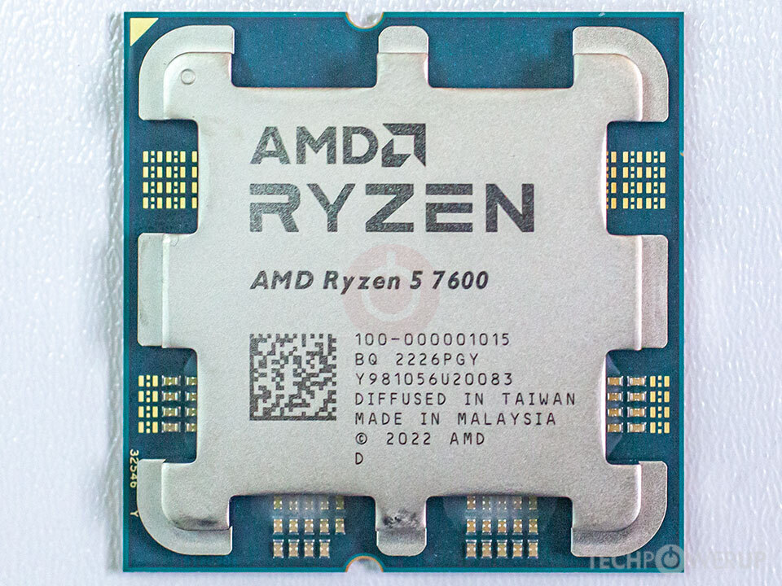
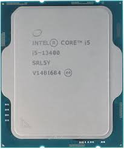
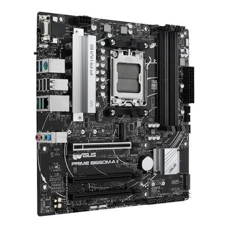
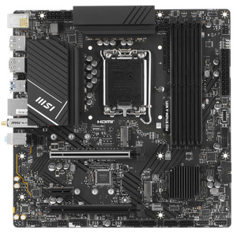
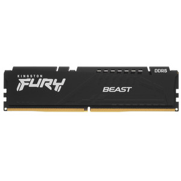
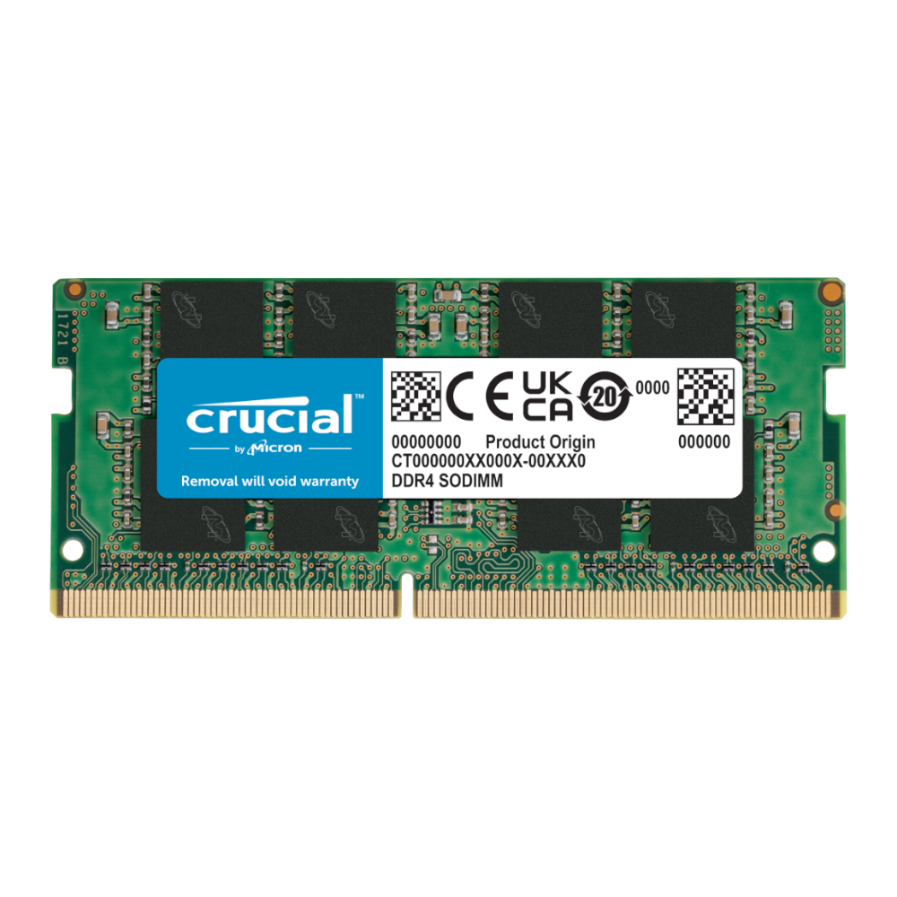
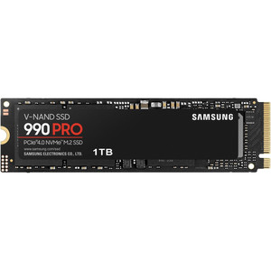
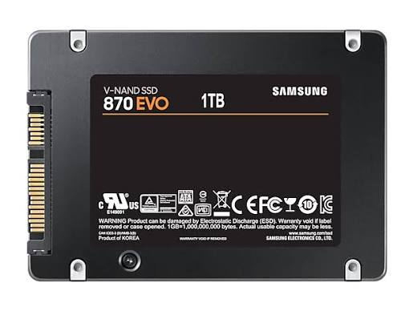
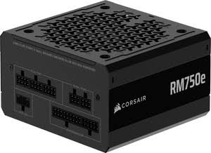
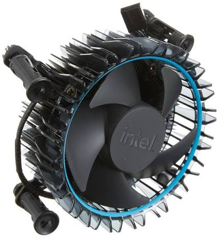

# Lab 3 — Teardown, and the same machine from the command line

Pair: shemetova + zadorozhnaya  · Date: 08.11.2026

## Part 1 — Ten parts
### AMD Ryzen 5 7600


Caption: Desktop Central Processing Unit (CPU) featuring 6 cores and 12 threads based on Zen 4 architecture. Connects directly to an AMD Socket AM5 (LGA1718) motherboard socket and relies on dual-channel DDR5 system memory. Limit: Requires an AM5 motherboard and DDR5 RAM only (incompatible with AM4 and DDR4); does not support legacy socket architectures. Ships with an included AMD Wraith Stealth stock cooler  — Source: <https://www.amd.com/en/products/processors/desktops/ryzen/7000-series/amd-ryzen-5-7600.html>

### Intel Core i5-13400


Caption: Desktop Central Processing Unit (CPU) with 10 cores (6 Performance-cores + 4 Efficient-cores) and 16 threads based on Raptor Lake architecture. Connects to an Intel LGA1700 CPU socket and supports both DDR4 and DDR5 memory controllers. Limit: Restricted to LGA1700 motherboards (Intel 600/700 series chipsets); cannot fit older LGA1200 or AMD platforms. Includes an Intel Laminar RM1 stock cooler in the box — Source: <https://www.intel.com/content/www/us/en/products/sku/230495/intel-core-i513400-processor-20m-cache-up-to-4-60-ghz/specifications.html>

### ASUS PRIME B650M-A


Caption: Micro-ATX Motherboard built on the AMD B650 chipset featuring an LGA1718 (Socket AM5) CPU socket. Connects the CPU, up to 4 DDR5 DIMM slots, PCIe 4.0 expansion cards, M.2 NVMe SSDs, SATA drives, and 24-pin ATX + 8-pin EPS power cables from the PSU. Limit: Supports AMD Ryzen 7000, 8000, and 9000 Series desktop processors only; strictly incompatible with DDR4 RAM and Intel CPUs — Source: <https://www.asus.com/ru/motherboards-components/motherboards/prime/prime-b650m-a/>

### MSI PRO B760M-A WIFI DDR4


Caption: Micro-ATX Motherboard based on the Intel B760 chipset with an LGA1700 CPU socket. Connects the processor, up to 4 DDR4 DIMM slots, PCIe 4.0 expansion slots, M.2 PCIe SSDs, SATA 6Gb/s drives, and system power inputs. Limit: Supports 12th, 13th, and 14th Gen Intel Core, Pentium Gold, and Celeron processors only; strictly requires DDR4 memory and physically cannot fit DDR5 RAM — Source: <https://www.msi.com/Motherboard/PRO-B760M-A-WIFI-DDR4>

### Kingston FURY Beast DDR5-5600 16 GB


Caption: 288-pin DDR5 Unbuffered DIMM desktop memory module operating at up to 5600 MT/s. Connects to a standard desktop DDR5 DIMM slot on compatible motherboards. Limit: Incompatible with DDR4 DIMM slots due to physical key notch placement and onboard PMIC voltage routing; requires a DDR5-compatible motherboard and CPU memory controller — Source: <https://www.kingston.com/en/memory/gaming/kingston-fury-beast-ddr5-memory>

### Crucial DDR4-3200 16 GB DIMM


Caption: 288-pin DDR4 Unbuffered DIMM desktop memory module running at 3200 MT/s at 1.2V. Connects to a 288-pin desktop DDR4 DIMM motherboard slot, operating one channel per DIMM populated. Limit: Incompatible with DDR5 motherboard slots and laptop SO-DIMM slots due to pin configuration and physical keying — Source: <https://www.crucial.com/memory/ddr4/ct16g4dfra32a?srsltid=AYCX9vLeuw52nxa7it1TjmrxL-ATlP7sY5qVWvlIg2TSyvS6mL5YXLde>

### Samsung 990 PRO 1 TB


Caption: M.2 2280 form-factor Solid State Drive using the NVMe 2.0 protocol over a PCIe 4.0 x4 interface. Connects directly to an M.2 PCIe (M-Key) slot on the motherboard. Limit: Requires an M.2 slot with PCIe support to operate (not compatible with SATA-only M.2 slots or 2.5-inch drive bays); backward compatible with PCIe 3.0 but capped at lower bandwidth — Source: <https://www.samsung.com/uk/memory-storage/nvme-ssd/990-pro-1tb-nvme-pcie-gen-4-mz-v9p1t0bw/>

### Samsung 870 EVO 1 TB


Caption: 2.5-inch form-factor Solid State Drive operating on the SATA III 6 Gbps interface. Connects to the motherboard via a 7-pin SATA data cable and to the power supply via a 15-pin SATA power connector. Limit: Maximum sequential transfer speed is bottlenecked by the SATA III interface limit (~560 MB/s); cannot fit directly into M.2 motherboard slots — Source: <https://www.samsung.com/kz_ru/memory-storage/sata-ssd/870-evo-1tb-sata-3-2-5-ssd-mz-77e1t0bw/?srsltid=AYCX9vKHZFU8BT7usonrGMq3BarVfOHFUTJpNJ5-uMEdcAgU9EJjGaRF>

### Corsair RM750e (750 W)


Caption: 750-Watt Fully Modular ATX Power Supply Unit (PSU) with 80 PLUS Gold certification. Connects to wall AC power and distributes DC power to system components via modular internal cables (24-pin ATX, 8-pin EPS/CPU, PCIe graphics connectors, and SATA power cables). Limit: Constrained by standard ATX chassis form-factor dimensions and a maximum total continuous power delivery budget of 750 W — Source: <https://www.corsair.com/ww/ru/p/psu/cp-9020248-ww/rme-series-rm750e-fully-modular-low-noise-atx-power-supply-cp-9020248-ww?srsltid=AYCX9vKGf1MkNxeOWwpJd4E-JyLPDFzJcrbqqsu6VT9euagUU92Y4NHm>

### Stock CPU Coolers (AMD Wraith Stealth / Intel Laminar RM1)


Caption: Low-profile air CPU coolers with pre-applied thermal interface material and a 4-pin PWM fan connector. Connects directly to the CPU socket retention mechanism/mounting holes on the motherboard and plugs into the 4-pin CPU_FAN header. Limit: Designed only for thermal loads up to ~65W TDP CPUs (comes bundled in-box with Ryzen 5 7600 and Core i5-13400); incompatible with cross-platform mounting patterns without dedicated bracket adapters — Source: <https://www.amd.com/en/products/processors/desktops/ryzen/7000-series/amd-ryzen-5-7600.html>


## Two builds
### Build 1
| Part | Model | Why it fits here |
| :--- | :--- | :--- |
| **CPU** | AMD Ryzen 5 7600 | Mounts directly into the AM5 socket of the ASUS motherboard, running on the modern Zen 4 architecture. |
| **Motherboard** | ASUS PRIME B650M-A | Features the AM5 socket and DDR5 slots required to natively support the Ryzen 5 7600 CPU and DDR5 memory module. |
| **Memory** | Kingston FURY Beast DDR5-5600 16 GB | Fits into the DDR5 DIMM slots of the ASUS motherboard, matching its memory controller architecture. |
| **Storage** | Samsung 990 PRO 1 TB | Plugs straight into the motherboard's M.2 PCIe 4.0 slot, leveraging high-speed NVMe data transfer lanes. |
| **PSU** | Corsair RM750e (750 W) | Supplies clean modular DC power (24-pin ATX and 8-pin EPS) to the motherboard, CPU, and expansion components. |
| **Cooler** | AMD Wraith Stealth (Stock) | Bundled in-box with the Ryzen 5 7600; mounts securely onto the AM5 retention mechanism to cool the 65W TDP chip. |

What this build still needs: A PC case (chassis) to house the components, a dedicated discrete graphics card (GPU), and ideally a second matching 16 GB DDR5 stick to enable dual-channel memory performance.


### Build 2
| Part | Model | Why it fits here |
| :--- | :--- | :--- |
| **CPU** | Intel Core i5-13400 | Drops into the LGA1700 socket of the MSI motherboard, utilizing hybrid P-core and E-core processing. |
| **Motherboard** | MSI PRO B760M-A WIFI DDR4 | Provides the LGA1700 socket for the Intel CPU and physical DDR4 memory slots matching the Crucial RAM module. |
| **Memory** | Crucial DDR4-3200 16 GB DIMM | Inserts into the motherboard's DDR4 DIMM slots, aligning with the board's strict DDR4 memory architecture. |
| **Storage** | Samsung 870 EVO 1 TB | Connects via a 7-pin SATA data cable to the motherboard's SATA ports and a SATA power connector from the PSU. |
| **PSU** | *(Shared or second PSU required)* | Note: In a dual-build lab scenario where both systems run concurrently, a second power supply unit is required as only one Corsair RM750e is provided in the parts list. |
| **Cooler** | Intel Laminar RM1 (Stock) | Comes included with the Intel processor and mounts onto the LGA1700 socket holes to handle basic thermal loads. |

What this build still needs: A PC case (chassis), a discrete graphics card (GPU), a SATA data cable to connect the 870 EVO SSD to the board, and a second power supply unit if both computers are to be powered on simultaneously.

## Part 2 — Same facts, three operating systems

| Fact | Windows (PowerShell) | Linux (Ubuntu VM) | macOS |
|---|---|---|---|
| CPU model | AMD Ryzen 7 7435HS (`Get-CimInstance Win32_Processor`) | AMD Ryzen 7 7435HS (`lscpu`) | Apple M5 (`sysctl -n machdep.cpu.brand_string`) |
| Cores / threads | 8 cores / 16 threads (`Get-CimInstance Win32_Processor`) | 2 virtual CPUs / 2 threads (`lscpu`) | 10 physical / 10 logical (`sysctl hw.physicalcpu hw.logicalcpu`) |
| Total memory | 24 GB (`Get-CimInstance Win32_PhysicalMemory`) | 956 MiB usable (~1 GiB assigned) (`free -h`) | 16 GB (`sysctl hw.memsize`) |
| Memory modules and speed | 2 × 12 GB, DDR5, 4800 MT/s (`Get-CimInstance Win32_PhysicalMemory`) | Not reported by VM (`sudo dmidecode -t memory`) | 16 GB LPDDR5, Micron (Unified, on-package) (`system_profiler SPMemoryDataType`) |
| Disk model and type | Micron MTFDKCD512QFM-1BD1AABLA, 512 GB NVMe SSD (`Get-PhysicalDisk`) | VBOX HARDDISK, 25 GB virtual SATA disk (`lsblk`) | APPLE SSD AP0512Z, 500.3 GB SSD (Apple Fabric) (`diskutil info disk0`) |
| Free space | 45.71 GB (`Get-Volume C`) | 20 GB (`df -h /`) | Not queried / Part of APFS container |
| Architecture (x86-64 / ARM64) | AMD64 / x86-64 (`$env:PROCESSOR_ARCHITECTURE`) | x86_64 (`uname -m`) | arm64 (`uname -m`) |

*Windows reports the physical hardware of the host laptop, while Ubuntu runs inside a virtual machine and reports the resources allocated to it. For example, Windows detects 8 CPU cores, 16 threads, and 24 GB of RAM, whereas Ubuntu shows only 2 virtual CPUs and approximately 1 GiB of RAM. The hypervisor passes through the CPU model and x86-64 architecture but presents a virtual SATA disk instead of the physical NVMe SSD and does not expose the real memory module specifications. In contrast, macOS runs natively on Apple Silicon (M5 arm64), exposing unified on-package LPDDR5 memory and an internal Apple Fabric storage controller directly.*

## What did not work the first time
- At first i couldn't get the dmidecode report. When I tried to retrieve the output of this command via SSH, it couldn't be accessed because an additional password was required. To resolve this, I logged into Ubuntu via an interactive SSH session and obtained the result from there by running these commands:
```
sudo dmidecode -t memory > dmidecode-output.txt
scp -P 2222 vita@127.0.0.1:dmidecode-output.txt dmidecode-output.txt
```

## Evidence
- [evidence/windows-specs.txt](evidence/windows-specs.txt) — Raw text output of hardware specifications and disk metrics captured via PowerShell commands (`Get-CimInstance`, `Get-PhysicalDisk`, etc.) on Windows.
- [evidence/linux-specs.txt](evidence/linux-specs.txt) — Raw text output of system, CPU, memory, and disk specifications (`lscpu`, `free -h`, `lsblk`, `df -h`) captured inside the Ubuntu Linux virtual machine.
- [evidence/dmidecode-output.txt](evidence/dmidecode-output.txt) — Raw memory device specifications exported via `sudo dmidecode -t memory` on the Ubuntu VM (showing virtualized SMBIOS constraints).
- [evidence/macos-specs.txt](evidence/macos-specs.txt) — Raw text output of hardware specifications, unified memory, and storage details captured via native utilities (`sysctl`, `system_profiler`, `diskutil`) on macOS.
- [evidence/photos/ryzen5-7600.jpg](evidence/photos/ryzen5-7600.jpg) — Official maker photo and visual reference for the AMD Ryzen 5 7600 processor.
- [evidence/photos/i5-13400.jpg](evidence/photos/i5-13400.jpg) — Official maker photo and visual reference for the Intel Core i5-13400 processor.
- [evidence/photos/asus-prime-b650m-a.jpg](evidence/photos/asus-prime-b650m-a.jpg) — Official maker photo and layout reference for the ASUS PRIME B650M-A motherboard.
- [evidence/photos/msi-pro-b760m-a-wifi-ddr4.jpg](evidence/photos/msi-pro-b760m-a-wifi-ddr4.jpg) — Official maker photo and layout reference for the MSI PRO B760M-A WIFI DDR4 motherboard.
- [evidence/photos/kingston-fury-beast-ddr5.jpg](evidence/photos/kingston-fury-beast-ddr5.jpg) — Official maker photo of the Kingston FURY Beast DDR5-5600 16 GB memory module.
- [evidence/photos/crucial-ddr4-3200.jpg](evidence/photos/crucial-ddr4-3200.jpg) — Official maker photo of the Crucial DDR4-3200 16 GB DIMM memory module.
- [evidence/photos/samsung-990-pro.jpg](evidence/photos/samsung-990-pro.jpg) — Official maker photo of the Samsung 990 PRO 1 TB M.2 NVMe SSD.
- [evidence/photos/samsung-870-evo.jpg](evidence/photos/samsung-870-evo.jpg) — Official maker photo of the Samsung 870 EVO 1 TB 2.5-inch SATA SSD.
- [evidence/photos/corsair-rm750e.jpg](evidence/photos/corsair-rm750e.jpg) — Official maker photo of the Corsair RM750e (750 W) fully modular power supply unit.
- [evidence/photos/stock-coolers.jpg](evidence/photos/stock-coolers.jpg) — Official maker photo showcasing the bundled stock air coolers (AMD Wraith Stealth / Intel Laminar RM1).
