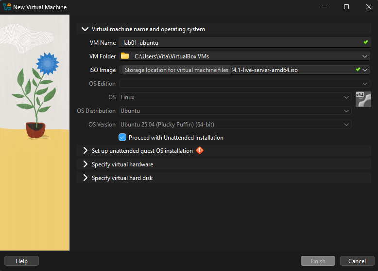
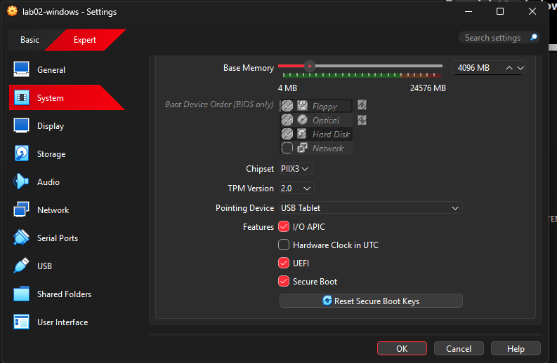
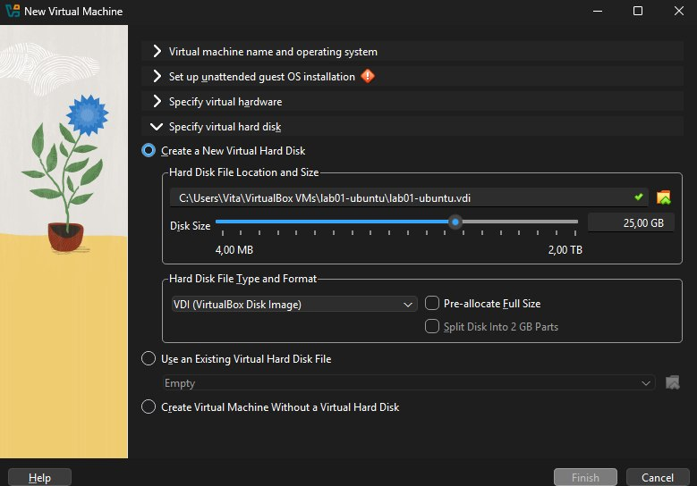
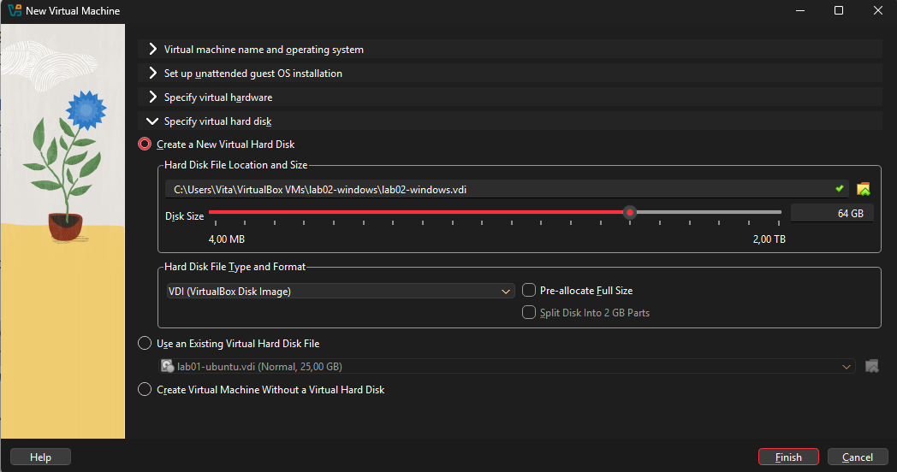
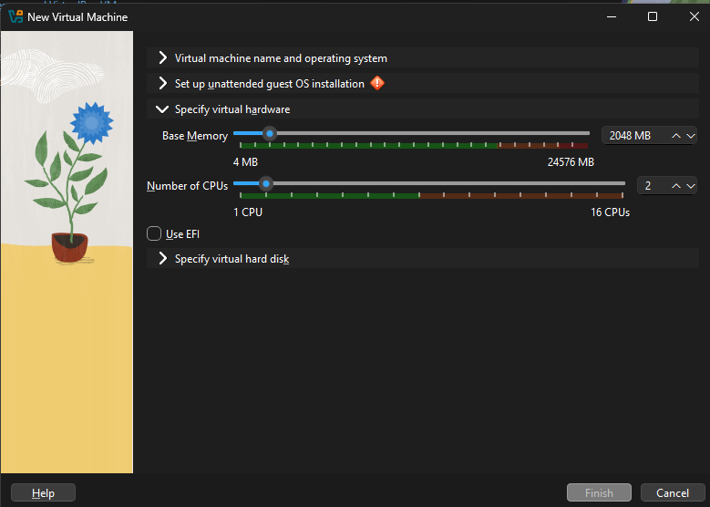
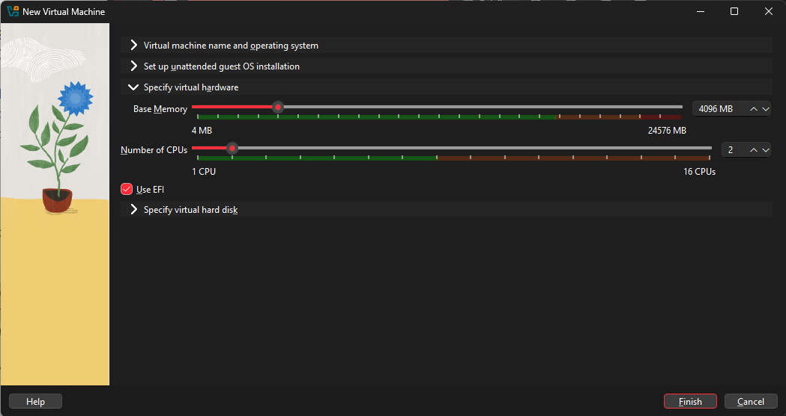
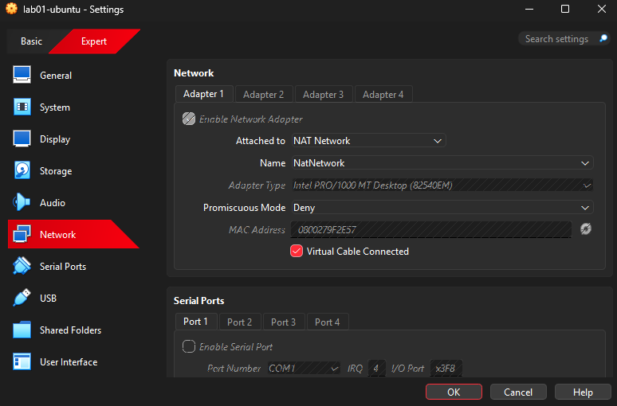
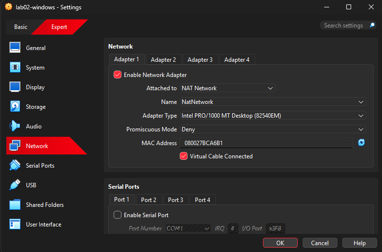
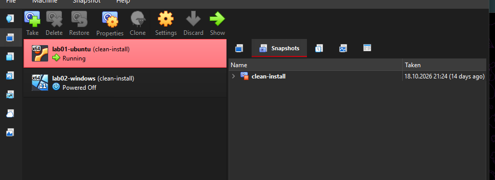
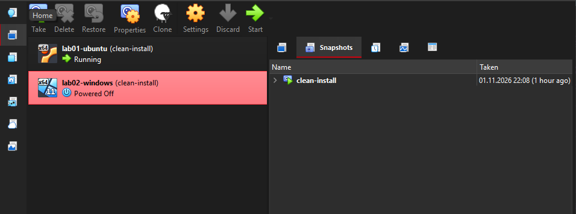

<<<<<<< HEAD:tickets/ticket1-vm-build-doc/BUILD.md.txt
## Step 1. Creating Ubuntu and Windows Virtual Machines
=======
## Prerequisites
Before starting, you need to download and install the required tools:
- **Oracle VirtualBox:** Download from the [official VirtualBox website](https://www.virtualbox.org/).
- **Ubuntu ISO:** Download the Ubuntu LTS ISO image from the [Ubuntu releases page](https://releases.ubuntu.com/).
- **Windows 11 ISO:** Download the Windows 11 Enterprise Evaluation ISO from the [Microsoft Evaluation Center](https://www.microsoft.com/en-us/evalcenter/download-windows-11-enterprise).
>>>>>>> 9bb8bf0d14afa855d37cae4c2436fd061550f57d:tickets/ticket1-vm-build-doc/BUILD.md


## Step 1. Creating Ubuntu and Windows Virtual Machines

**Ubuntu VM**
1. Open Oracle VirtualBox.
2. Click New to open the New Virtual Machine wizard.
3. Enter `lab01-ubuntu` as the VM name. Leave the VM folder at its default location unless that disk has insufficient free space.
4. Under ISO Image, browse to and select the Ubuntu ISO file.
5. Set OS to Linux and OS Version to Ubuntu (64-bit).
6. Uncheck *Proceed with Unattended Installation* so that you can follow the installer manually.
7. Keep the wizard open for the hardware and disk settings in Steps 2–3.



*Why: Ubuntu LTS provides a Linux environment for development and testing. Using the Ubuntu (64-bit) profile gives VirtualBox suitable starting defaults. Manual installation makes the process easier to explain and reproduce.*

**Windows VM**
1. In the main VirtualBox window, click New again.
2. Enter `lab02-windows` as the VM name.
3. Select the Windows 11 Enterprise Evaluation (x64) ISO file.
4. Set OS to Microsoft Windows and OS Version to Windows 11 (64-bit).
5. Uncheck *Proceed with Unattended Installation*.
6. Continue with Steps 2–3 for its hardware and disk configuration.



<<<<<<< HEAD:tickets/ticket1-vm-build-doc/BUILD.md.txt
Why: Windows provides a second operating-system environment for checking whether software behaves differently from Linux. The Evaluation edition is intended for testing rather than permanent production use. Manual installation allows the user to verify each installer choice.

---

## Step 2. Allocating RAM and CPU

Ubuntu VM
1. In the Ubuntu wizard, expand *Specify virtual hardware*.
=======
*(Note for Windows 11: Windows 11 requires UEFI and TPM 2.0. Ensure that `Enable EFI` and `TPM Version 2.0` are checked under Settings → System → Motherboard before installation, rather than bypassing system requirements).*

*Why: Windows provides a second operating-system environment for checking whether software behaves differently from Linux. The Enterprise Evaluation edition is intended for testing rather than permanent production use. Manual installation allows the user to verify each installer choice.*

## Step 2. Allocating RAM and CPU

**For Ubuntu VM:**
1. Expand the "Specify Virtual Hardware" section.
>>>>>>> 9bb8bf0d14afa855d37cae4c2436fd061550f57d:tickets/ticket1-vm-build-doc/BUILD.md
2. Set Base Memory to 4096 MB (4 GB).
3. Set Number of CPUs to 2.
4. Keep other controls as shown in your recorded configuration.

<<<<<<< HEAD:tickets/ticket1-vm-build-doc/BUILD.md.txt


Why: 4096 MB and 2 CPU cores provide sufficient resources for basic operating system tasks and software testing while balancing performance and resource usage so the host computer remains responsive.

Windows VM
1. Expand *Specify virtual hardware* in the Windows wizard.
=======


**For Windows VM:**
1. Expand the "Specify Virtual Hardware" section.
>>>>>>> 9bb8bf0d14afa855d37cae4c2436fd061550f57d:tickets/ticket1-vm-build-doc/BUILD.md
2. Set Base Memory to 4096 MB (4 GB).
3. Set Number of CPUs to 2.
4. Check the settings of your already-created Windows VM under Settings → System → Motherboard / Processor to ensure they match.

<<<<<<< HEAD:tickets/ticket1-vm-build-doc/BUILD.md.txt

=======


*Why: Both virtual machines were allocated 4 GB of RAM and 2 CPU cores to provide sufficient resources for basic operating system tasks and software testing. These settings balance performance and resource usage, allowing the host computer to remain responsive. Using the same hardware configuration also makes it easier to compare the two operating systems.*
>>>>>>> 9bb8bf0d14afa855d37cae4c2436fd061550f57d:tickets/ticket1-vm-build-doc/BUILD.md

Why: Windows 11 generally needs adequate resources for usability. Allocating 4 GB RAM and 2 CPUs balances performance and leaves enough memory headroom for the host system and the Ubuntu VM running simultaneously.

<<<<<<< HEAD:tickets/ticket1-vm-build-doc/BUILD.md.txt
---

## Step 3. Creating the virtual hard disks

Ubuntu VM
1. Expand *Specify virtual hard disk*.
2. Select *Create a New Virtual Hard Disk*.
3. Set Disk Size to 25 GB.
4. Select **VDI (VirtualBox Disk Image)**.
5. Leave *Pre-allocate Full Size* unchecked.
6. Click Finish to create the VM.


Why: VDI is VirtualBox's native disk format. With full-size preallocation disabled, the file grows as data is written instead of immediately occupying all 25 GB on the host. The 25 GB disk leaves enough space for using Ubuntu during labs.
=======
## Step 3. Creating the Virtual Hard Disks

**For Ubuntu VM:**
1. Expand the "Specify Virtual Hard Disk" section.
2. Select "Create a New Virtual Hard Disk".
3. Set the disk size to 25 GB.
4. Select VDI (VirtualBox Disk Image) as the disk format.
5. Leave "Pre-allocate Full Size" unchecked.
6. Continue with the virtual machine creation.



**For Windows VM:**
1. Expand the "Specify Virtual Hard Disk" section.
2. Select "Create a New Virtual Hard Disk"
3. Set the disk size to 25 GB.
4. Select VDI (VirtualBox Disk Image) as the disk format.
5. Leave "Pre-allocate Full Size" unchecked.
6. Continue with the virtual machine creation.



*Why: Both virtual machines were assigned 25 GB of virtual disk space to minimize storage consumption on the host computer. The VDI format was selected because it is the native disk format of VirtualBox. Full-size preallocation was disabled so that the virtual disk files grow as data is added, rather than immediately occupying the entire allocated space.*

**Note:** While 25 GB may be sufficient for a minimal Ubuntu installation, it is below the recommended storage requirement for Windows 11. A larger virtual disk would be preferable for Windows to accommodate updates and additional software.
>>>>>>> 9bb8bf0d14afa855d37cae4c2436fd061550f57d:tickets/ticket1-vm-build-doc/BUILD.md

Windows VM
1. Choose *Create a New Virtual Hard Disk*.
2. Select VDI, set Disk Size to 25 GB (or adjust based on your actual configuration), and leave *Pre-allocate Full Size* unchecked.
3. Compare these values with Settings → Storage on your existing Windows VM.
4. Click Finish.


Why: A dynamically allocated VDI uses less physical storage initially, growing as needed. Note that while 25 GB is a practical starting point for testing, Windows 11 typically benefits from a larger disk to comfortably accommodate future system updates and development tools.

---

## Step 4. Installing the operating systems

<<<<<<< HEAD:tickets/ticket1-vm-build-doc/BUILD.md.txt
Ubuntu installation
1. Select `lab01-ubuntu` in VirtualBox and click **Start**.
2. When the Ubuntu installer appears, choose *Install Ubuntu*.
=======
## Step 4. Installing the operating systems
**Ubuntu installation**
1. Select lab01-ubuntu in VirtualBox and click Start.
2. When the Ubuntu installer appears, choose Install Ubuntu (or Try or Install Ubuntu, then Install Ubuntu, depending on the installer screen).
>>>>>>> 9bb8bf0d14afa855d37cae4c2436fd061550f57d:tickets/ticket1-vm-build-doc/BUILD.md
3. Select the appropriate language and keyboard layout.
4. Choose the normal/default installation option.
5. When asked where to install, select the virtual disk created in Step 3 (confirm it is the 25 GB virtual disk, not your physical host drive).
6. Create a local username and password. Record the username privately; do not publish the password in the repository.
7. Complete installation and restart the VM. If prompted to remove installation media, use Devices → Optical Drives to eject the ISO, then press Enter.
8. Log in and confirm that the Ubuntu desktop opens.

<<<<<<< HEAD:tickets/ticket1-vm-build-doc/BUILD.md.txt


Why: Installing onto the virtual disk keeps test software separate from the physical laptop. A local test account is sufficient for the assignment and avoids exposing real personal credentials.

Windows installation
1. Select `lab02-windows` and click **Start**.
2. Follow the Windows Setup screens and select language and keyboard settings.
3. Choose the Windows 11 Enterprise Evaluation edition if prompted.
4. For the destination, select the unallocated space on the Windows VM's virtual disk.
=======
*Why: Installing onto the virtual disk keeps test software separate from the physical laptop. A local test account is sufficient for the assignment and avoids exposing real personal credentials.*

**Windows installation**
1. Select lab02-windows and click Start.
2. Follow the Windows Setup screens and select the appropriate language and keyboard settings.
3. Choose the Windows 11 Enterprise Evaluation edition if the installer asks for an edition.
4. For the destination, select the unallocated space on the Windows VM's virtual disk. Do not select or format a disk belonging to the physical host.
>>>>>>> 9bb8bf0d14afa855d37cae4c2436fd061550f57d:tickets/ticket1-vm-build-doc/BUILD.md
5. Complete the installation and restart when required.
6. Follow first-run setup screens to create the permitted test account and configure privacy settings.
7. Log in and confirm that the Windows desktop opens.

<<<<<<< HEAD:tickets/ticket1-vm-build-doc/BUILD.md.txt


Why: A separate Windows guest lets a developer test Windows-specific behavior without modifying the host operating system. The evaluation edition is temporary and intended strictly for testing.
=======
*Why: A separate Windows guest lets a developer test Windows-specific behavior without modifying the host operating system. The evaluation edition is temporary, so it should not be treated as a permanent licensed workstation.*
>>>>>>> 9bb8bf0d14afa855d37cae4c2436fd061550f57d:tickets/ticket1-vm-build-doc/BUILD.md

---

## Step 5. Network configuration (both VMs)

<<<<<<< HEAD:tickets/ticket1-vm-build-doc/BUILD.md.txt
=======
## Step 5. Network configuration (both VMs)
>>>>>>> 9bb8bf0d14afa855d37cae4c2436fd061550f57d:tickets/ticket1-vm-build-doc/BUILD.md
1. Shut down both virtual machines before changing their network settings.
2. In VirtualBox, open Tools → Network Manager. Find **NAT Networks** and create a NAT Network if one does not exist. Leave DHCP enabled.
3. Select `lab01-ubuntu` → Settings → Network → Adapter 1.
4. Check *Enable Network Adapter*.
5. Set *Attached to* to **NAT Network**, and select your created NAT Network.
6. Open Advanced and confirm *Cable Connected* is checked. Click OK.
7. Repeat steps 3–6 for `lab02-windows`, using the same NAT Network.
8. Start both guests.

<<<<<<< HEAD:tickets/ticket1-vm-build-doc/BUILD.md.txt



Why: A shared NAT Network gives both guests internet access through the host and allows them to communicate with each other directly, unlike separate default NAT connections. It avoids MAC address filtering issues present on some physical campus networks.
> Check: run `ip addr` inside Ubuntu and `ipconfig` inside Windows to verify they receive addresses on the same subnet (e.g., `10.0.2.x` or custom NAT network range).
=======
 


*Why: A shared NAT Network gives both guests internet access through the host and allows them to communicate with each other. Unlike a bridged adapter, it does not require the guests to appear as separate machines on the physical teaching network. NAT and NAT Network are different options: two guests on separate default NAT connections usually cannot reach each other directly. A NAT Network is not a security sandbox against all network threats, so use only disposable test data.*
>>>>>>> 9bb8bf0d14afa855d37cae4c2436fd061550f57d:tickets/ticket1-vm-build-doc/BUILD.md

---

## Step 6. Checking the installed systems and internet access
<<<<<<< HEAD:tickets/ticket1-vm-build-doc/BUILD.md.txt

Ubuntu verification
1. To collect evidence remotely from the host via SSH (using port forwarding configured on port 2222), run:
   ```bash
   ssh -p 2222 vita@127.0.0.1 "uname -a; lsb_release -a" > evidence/uname-result.txt
 ```
2. Confirm that the command outputs show the Linux kernel version and distribution details.
=======
**Ubuntu**
1. In Ubuntu, ensure SSH is available or use the VirtualBox console. To collect evidence remotely from the host via SSH (using port forwarding configured on port 2222), run:

```Bash
ssh -p 2222 vita@127.0.0.1 "uname -a; lsb_release -a" > evidence/uname-result.txt
```
>>>>>>> 9bb8bf0d14afa855d37cae4c2436fd061550f57d:tickets/ticket1-vm-build-doc/BUILD.md


<<<<<<< HEAD:tickets/ticket1-vm-build-doc/BUILD.md.txt
Why: A visible desktop alone does not prove the operating system works correctly. Command-line checks provide reproducible evidence of the system version and configuration.

Windows verification

1. In Windows, open PowerShell and run these commands:
=======
*Why: A visible desktop alone does not prove the operating system or networking works. These commands provide reproducible evidence of the Linux version, IP configuration and internet access.*

**Windows**
1. In Windows, open PowerShell (Start → type PowerShell).
2. Run these commands to gather system and network information:

>>>>>>> 9bb8bf0d14afa855d37cae4c2436fd061550f57d:tickets/ticket1-vm-build-doc/BUILD.md
```PowerShell
systeminfo
ipconfig
ping ubuntu.com
```
<<<<<<< HEAD:tickets/ticket1-vm-build-doc/BUILD.md.txt
2. Save the results into your host's evidence folder as 04-windows-system-info.txt 
=======
Confirm that systeminfo identifies Windows, ipconfig shows an IPv4 address, and ping receives replies.
>>>>>>> 9bb8bf0d14afa855d37cae4c2436fd061550f57d:tickets/ticket1-vm-build-doc/BUILD.md


<<<<<<< HEAD:tickets/ticket1-vm-build-doc/BUILD.md.txt
Why: This proves that the Windows guest is operational, has an active IP configuration, and can reach external networks.
=======
*Why: This proves that the Windows guest is installed and connected, rather than assuming it is operational just because VirtualBox starts it.*
>>>>>>> 9bb8bf0d14afa855d37cae4c2436fd061550f57d:tickets/ticket1-vm-build-doc/BUILD.md

---

## Step 7. Testing communication between the two guests and fixing the firewall
<<<<<<< HEAD:tickets/ticket1-vm-build-doc/BUILD.md.txt
1. Find both addresses:

On Windows: Run ipconfig in PowerShell and save it:
=======
1.Find both addresses:

**On Windows:** Open PowerShell and run ipconfig. Note the IPv4 address of the adapter (e.g., 192.168.80.131). Save it using:

>>>>>>> 9bb8bf0d14afa855d37cae4c2436fd061550f57d:tickets/ticket1-vm-build-doc/BUILD.md
```PowerShell
ipconfig | Set-Clipboard
Paste the output into evidence/ipconfig-windows.txt.
```

<<<<<<< HEAD:tickets/ticket1-vm-build-doc/BUILD.md.txt
On Ubuntu: Find the IP address using ip -br a and save the output from your host via SSH:
=======
**On Ubuntu:** Find the IP address using ip -br a (e.g., 192.168.80.130). Save the output from your host via SSH:
>>>>>>> 9bb8bf0d14afa855d37cae4c2436fd061550f57d:tickets/ticket1-vm-build-doc/BUILD.md

```Bash
ssh -p 2222 vita@127.0.0.1 "ip addr" > evidence/ip-addr-linux.txt
```
Test Windows → Ubuntu:
```

<<<<<<< HEAD:tickets/ticket1-vm-build-doc/BUILD.md.txt
2. In PowerShell on Windows, run ping <Ubuntu_IP>. Replies succeed immediately because Ubuntu's firewall is inactive by default.
=======


2. In PowerShell on Windows, run:

```PowerShell
ping <Ubuntu_IP>
```
Replies come back immediately because Ubuntu's firewall is inactive by default.
>>>>>>> 9bb8bf0d14afa855d37cae4c2436fd061550f57d:tickets/ticket1-vm-build-doc/BUILD.md


3. Test Ubuntu → Windows (and handle the firewall properly):

**From Ubuntu, run:**

```Bash
ssh -p 2222 vita@127.0.0.1 "ping -c 4 <Windows_IP>"
```
<<<<<<< HEAD:tickets/ticket1-vm-build-doc/BUILD.md.txt
Note: The ping times out initially because Windows Defender Firewall blocks incoming ICMP echo requests by default on "Public" profiles.
=======
Note: The ping will likely time out initially. Why? Windows Defender Firewall blocks incoming ICMP echo requests by default on networks classified as "Public" (the strictest profile).
>>>>>>> 9bb8bf0d14afa855d37cae4c2436fd061550f57d:tickets/ticket1-vm-build-doc/BUILD.md

4. The correct fix: Open PowerShell as Administrator on Windows and add a specific inbound rule for ICMPv4:

```PowerShell
New-NetFirewallRule -DisplayName "Allow ping in (ICMPv4)" -Protocol ICMPv4 -IcmpType 8 -Direction Inbound -Action Allow
<<<<<<< HEAD:tickets/ticket1-vm-build-doc/BUILD.md.txt
Re-run the ping from Ubuntu—replies will now succeed.
```

5. Compile all ping and internet tests:
	Test internet connectivity from both guests (ping -c 4 ubuntu.com on Ubuntu and ping ubuntu.com on Windows).
	Combine all tests into a single file named evidence/ping-both-ways.txt.
=======
```
5. Re-run the ping from Ubuntu — replies will now succeed.

6. Prove internet access and compile all results:

7. Test internet connectivity from both guests (ping -c 4 ubuntu.com on Ubuntu and ping ubuntu.com on Windows).

8. Combine all ping tests into a single evidence file named evidence/ping-both-ways.txt with clear headings for each direction.
>>>>>>> 9bb8bf0d14afa855d37cae4c2436fd061550f57d:tickets/ticket1-vm-build-doc/BUILD.md

**Expected result:** Ubuntu → Windows, Windows → Ubuntu, Ubuntu → internet, and Windows → internet each return successful replies with 0% packet loss.

<<<<<<< HEAD:tickets/ticket1-vm-build-doc/BUILD.md.txt


Why: Internet access does not automatically guarantee that two VMs can reach each other. Testing both directions confirms guest-to-guest connectivity, and using a targeted firewall rule ensures security is maintained without recklessly disabling protection.

---

## Step 8. Creating recovery snapshots
Ubuntu snapshot
1. Shut down lab01-ubuntu normally from inside the guest.
=======
 

*Why: Internet access does not automatically mean that two VMs can reach one another. Testing both directions confirms guest-to-guest connectivity, and using a targeted firewall rule ensures security is maintained rather than recklessly disabling protection.*

## Step 8. Creating recovery snapshots
**Ubuntu**
1. Shut down lab01-ubuntu normally from inside Ubuntu.
>>>>>>> 9bb8bf0d14afa855d37cae4c2436fd061550f57d:tickets/ticket1-vm-build-doc/BUILD.md
2. In VirtualBox Manager, select the Ubuntu VM and open Snapshots.
3. Choose Take Snapshot, name it Ubuntu - Clean Installation, and confirm.

<<<<<<< HEAD:tickets/ticket1-vm-build-doc/BUILD.md.txt
Windows snapshot
=======
 

**Windows**
>>>>>>> 9bb8bf0d14afa855d37cae4c2436fd061550f57d:tickets/ticket1-vm-build-doc/BUILD.md
1. Shut down lab02-windows normally.
2. Select the Windows VM, open Snapshots, and click Take Snapshot.
3. Name it Windows - Clean Installation and confirm.

<<<<<<< HEAD:tickets/ticket1-vm-build-doc/BUILD.md.txt



Why: A snapshot records a recoverable VM state. If testing damages the guest configuration, the developer can revert to a clean state instantly instead of reinstalling the OS.
=======
 *(How to roll back: Select the snapshot and click Restore to revert all changes made since the snapshot was taken).*


*Why: A snapshot records a recoverable VM state. If testing damages the guest configuration, the developer can revert to a clean state instead of reinstalling the OS. Snapshots are not a substitute for backups of important files.*
>>>>>>> 9bb8bf0d14afa855d37cae4c2436fd061550f57d:tickets/ticket1-vm-build-doc/BUILD.md

---

## Step 9. Final checks and handover
1. Start both VMs and confirm that each reaches its desktop.
2. Confirm that both can reach the internet and each other using the commands in Steps 6–7.
3. Confirm that a clean-install snapshot exists for each guest.
<<<<<<< HEAD:tickets/ticket1-vm-build-doc/BUILD.md.txt
4. Keep virtual disks, ISO files, and credentials secure. Do not publish sensitive data or passwords.

Why: The handover is complete only when someone else can accurately reproduce the machines and verify that they function properly.
=======
4. Keep the virtual disks, ISO files and local test credentials under the control of the person responsible for the machines. Do not publish passwords or sensitive test data.
5. Keep this BUILD.md guide and the evidence/ folder accessible so you can independently rebuild and verify the next development machine yourself.

*Why: The handover is complete only when someone else (such as the office manager) can successfully follow the guide to reproduce the machines and verify that they work.*
>>>>>>> 9bb8bf0d14afa855d37cae4c2436fd061550f57d:tickets/ticket1-vm-build-doc/BUILD.md
